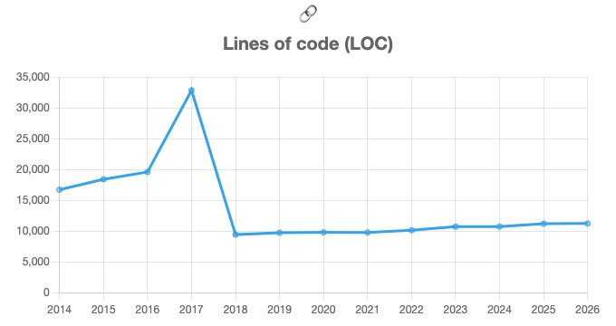

# Explorando evolução de código

Neste exercício, iremos explorar a evolução de código em sistemas reais.

Iremos utilizar a ferramenta [GitEvo](https://github.com/andrehora/gitevo).
Essa ferramenta analisa a evolução de código em repositórios Git nas linguagens Python, JavaScript, TypeScript e Java, e gera relatórios `HTML` como [este](https://andrehora.github.io/gitevo-examples/python/pandas.html).

Mais exemplos de relatórios podem ser podem ser encontrados em https://github.com/andrehora/gitevo-examples.

# Passo 1: Selecionar repositório a ser analisado

Selecione um repositório relevante na linguagem de sua preferência (Python, JavaScript, TypeScript ou Java).
Você pode encontrar projetos interessantes nos links abaixo:

- Python: https://github.com/topics/python?l=python
- JavaScript: https://github.com/topics/javascript?l=javascript
- TypeScript: https://github.com/topics/typescript?l=typescript
- Java: https://github.com/topics/java?l=java

# Passo 2: Instalar e rodar a ferramenta GitEvo

> [!NOTE]
> Antes de instalar a ferramenta, é recomendado criar e ativar um [ambiente virtual Python](https://packaging.python.org/en/latest/guides/installing-using-pip-and-virtual-environments/#create-and-use-virtual-environments).

Instale a ferramenta [GitEvo](https://github.com/andrehora/gitevo) com o comando:

```
$ pip install gitevo
```

Execute a ferramenta no repositório selecionado utilizando o comando abaixo (ajuste conforme a linguagem do repositório).
Substitua `<git_url>` pela URL do repositório que será analisado:

```shell
# Python
$ gitevo -r python <git_url>

# JavaScript
$ gitevo -r javascript <git_url>

# TypeScript
$ gitevo -r typescript <git_url>

# Java
$ gitevo -r java <git_url>
```

Por exemplo, para analisar o projeto Flask escrito em Python:

```
$ gitevo -r python https://github.com/pallets/flask
```

> [!NOTE]
> Essa etapa pode demorar alguns minutos pois o projeto será clonado e analisado localmente.

# Passo 3: Explorar o relatório de evolução de código

Após executar a ferramenta [GitEvo](https://github.com/andrehora/gitevo), é gerado um relatório `HTML` contendo diversos gráficos sobre a evolução do código.

Abra o relatório `HTML` e observe com atenção os gráficos.

# Passo 4: Explicar um gráfico de evolução de código

Selecione um dos gráficos de evolução e explique-o com suas palavras.
Por exemplo, você pode:

- Detalhar a evolução ao longo do tempo
- Detalhar se as curvas estão de acordo com boas práticas
- Explicar grandes alterações nas curvas
- Explorar a documentação do repositório em busca de explicações para grandes alterações
- etc.

Seja criativo!

# Instruções para o exercício

1. Crie um `fork` deste repositório (mais informações sobre forks [aqui](https://docs.github.com/pt/pull-requests/collaborating-with-pull-requests/working-with-forks/fork-a-repo)).
2. Adicione o relatório `HTML` no seu fork.
3. No Moodle, submeta apenas a URL do seu `fork`.

Responda às questões abaixo diretamente neste arquivo `README.md` do seu fork:

1. Repositório selecionado: https://github.com/psf/requests

   Relatório gerado com `gitevo -r python -f 2014 https://github.com/psf/requests`: [report_requests.html](report_requests.html) (dados brutos em [report_requests.csv](report_requests.csv)).

2. Gráfico selecionado: **Lines of code (LOC)**

   

3. Explicação:

   O gráfico mostra o total de linhas de código Python do `requests` em um snapshot por ano (o GitEvo pega o primeiro commit de cada ano, por isso cada ponto representa o estado do código no início do ano).

   **2014 a 2016 – crescimento moderado (≈16,7 mil → 19,6 mil LOC).** Nessa época o `requests` *vendorizava* suas dependências: cópias completas do `urllib3` e do `chardet` ficavam dentro do próprio repositório, em `requests/packages/`. Boa parte das linhas contadas, portanto, não era código do `requests`, e sim código de terceiros. O crescimento acompanha tanto a evolução da biblioteca quanto as atualizações dessas cópias.

   **2017 – pico (≈32,9 mil LOC).** Em outubro de 2016 o projeto passou a vendorizar também o `idna` (commit "Vendor idna v2.1"), que traz o arquivo `uts46data.py`, uma tabela Unicode gigantesca. Só o `idna` acrescentou cerca de 9 mil linhas, além de uma nova versão do `urllib3`. Isso também aparece em outros gráficos do relatório: o número de tuplas salta de 439 para 9.037 em 2017, justamente por causa das tabelas de dados do `idna`. O código "de verdade" do `requests` não mudou muito; quem inflou a métrica foi o código vendorizado.

   **2018 – queda brusca (≈9,5 mil LOC, de 106 para 35 arquivos).** Na versão **2.16.0 (26/05/2017)** o changelog (`HISTORY.md`) diz apenas *"Unvendor ALL the things!"*: o commit "delete packages" removeu `requests/packages/urllib3`, `chardet` e `idna`, que passaram a ser dependências normais declaradas no `setup.py` e instaladas via pip. A queda de mais de 70% não significa perda de funcionalidade; ela mostra que a maior parte do "tamanho" anterior nunca foi código próprio do projeto.

   **2018 a 2026 – estabilidade (≈9,5 mil → 11,3 mil LOC).** Desde então o tamanho fica quase plano, com crescimento lento (~2% ao ano), coerente com uma biblioteca madura em modo de manutenção, que recebe correções e pequenas melhorias e não grandes funcionalidades novas. Há mudanças estruturais nesse período que não alteram o LOC, como a troca do `chardet` (LGPL) pelo `charset_normalizer` (MIT) em 2021 e a mudança do código para o layout `src/` em 2023 (PR #6506). Também dá para ver o crescimento dos testes: de 1 arquivo de teste em 2014 para 10 em 2026.

   **Boas práticas.** O gráfico ilustra bem o trade-off do *vendoring*. Copiar dependências facilita a instalação (era uma grande preocupação no ecossistema Python antes do pip/wheels amadurecerem), mas infla o repositório, dificulta atualizações de segurança e duplica código que outros projetos já instalam. Com a remoção, o `requests` ficou menor, mais fácil de manter e alinhado à prática recomendada de declarar dependências. A lição para quem analisa métricas como LOC é que elas precisam de contexto: um salto ou uma queda pode refletir uma decisão de empacotamento, e não uma mudança real na complexidade do sistema.


